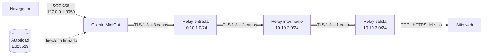
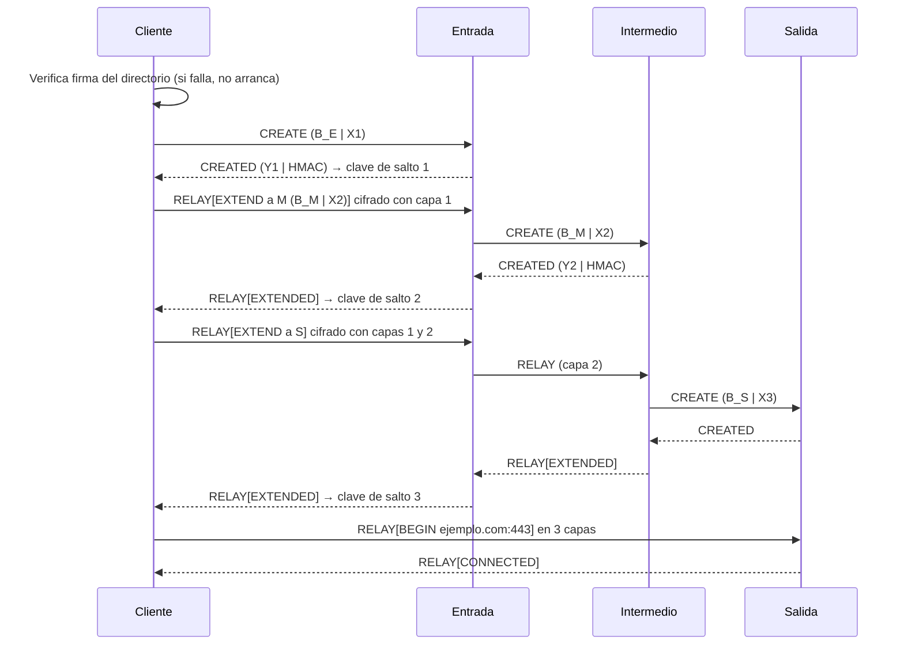
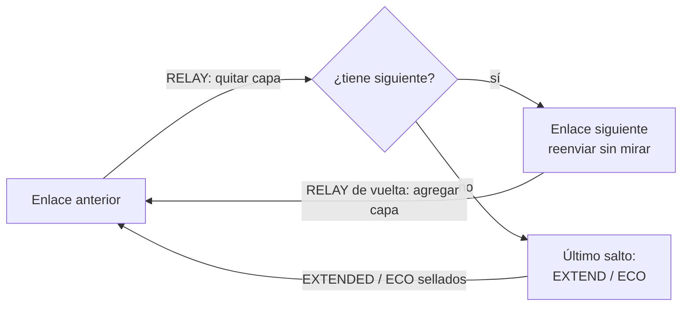
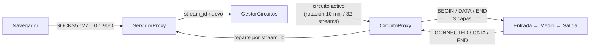
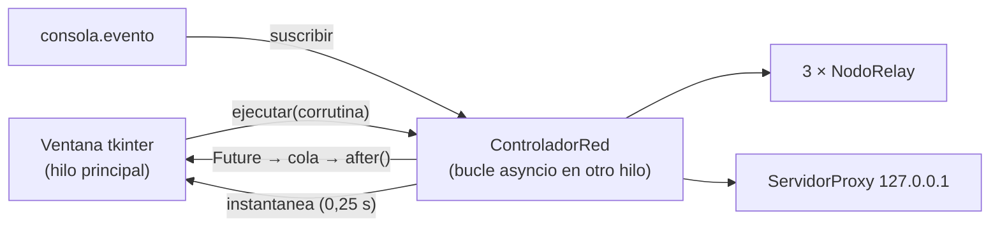

# Arquitectura de MiniOni

## 1. Problema

En una LAN corporativa o universitaria, aunque el tráfico web vaya cifrado con
HTTPS, el administrador o cualquier observador de la red puede ver **a qué
destinos se conecta cada equipo**. Con esos metadatos puede perfilar a los
usuarios. MiniOni oculta la relación origen–destino enrutando el tráfico del
navegador por un circuito cebolla de 3 nodos.

## 2. Componentes

| Componente | Dónde corre | Qué hace | Qué conoce |
|---|---|---|---|
| Navegador (Firefox / LibreWolf) | Equipo del usuario | Envía su tráfico al proxy SOCKS5 | Todo (es el usuario) |
| **Cliente MiniOni** (proxy SOCKS5) | Equipo del usuario, `127.0.0.1:9050` | Verifica el directorio, arma el circuito, cifra en 3 capas | Origen y destino (es del usuario) |
| **Relay de entrada** | Red segmentada 10.10.1.0/24 | Quita la capa 1 y reenvía | La IP del cliente, **no** el destino |
| **Relay intermedio** | Red segmentada 10.10.2.0/24 | Quita la capa 2 y reenvía | Solo los relays vecinos |
| **Relay de salida** | Red segmentada 10.10.3.0/24 | Quita la capa 3 y abre la conexión al destino | El destino, **no** la IP del cliente |
| **Autoridad del directorio** | Fuera de línea (equipo del administrador) | Firma la lista de relays con Ed25519 | Solo claves públicas |

## 3. Diagrama de componentes



Límites de confianza (ISO/IEC 27033, segmentación):

1. **Equipo del usuario ↔ LAN**: solo sale tráfico cifrado hacia el relay de entrada.
2. **Entre relays**: cada relay está en su propia subred; solo se permite el
   tráfico hacia el puerto MiniOni del siguiente salto.
3. **Relay de salida ↔ destino**: la política de salida bloquea redes internas.

## 4. Flujo de construcción del circuito



Regla clave: **solo el último salto del circuito interpreta los mensajes
RELAY**. Un relay con siguiente salto siempre quita su capa y reenvía, sin
mirar el contenido.

## 5. Estructura del código

```
MiniOni/
├── minioni/
│   ├── constantes.py       Tamaños y límites del protocolo
│   ├── errores.py          Excepciones con mensaje público genérico
│   ├── celdas.py           Formato de celdas y validación de entradas   (R1)
│   ├── capas.py            Cifrado por capas ChaCha20-Poly1305           (R2)
│   ├── handshake.py        Acuerdo de claves X25519 + HKDF + HMAC        (R3)
│   ├── directorio.py       Directorio firmado con Ed25519                 (R3)
│   ├── almacen_claves.py   Claves privadas cifradas con scrypt (reposo)
│   ├── politica_salida.py  Bloqueo de redes internas en el nodo de salida
│   ├── consola.py          Eventos de consola sin datos sensibles
│   ├── admin.py            Herramienta de administración
│   ├── transporte.py       TLS 1.3, pinning de la huella y clase Enlace      (semana 2)
│   ├── relay.py            Relay asyncio: máquina de estados y límites      (semana 2)
│   ├── circuito.py         Elección de ruta y construcción del circuito     (semana 2)
│   ├── socks5.py           Parser SOCKS5 (RFC 1928), sin resolver nombres   (semana 3)
│   ├── proxy.py            Proxy SOCKS5: gestor de circuitos y streams      (semana 3)
│   ├── control_red.py      Controlador de la red para el panel gráfico
│   ├── sin_registros.py    Verificación «sin registros» (búsqueda testigo + audit hooks)
│   └── confianza_windows.py Verificación TLS con el verificador de Windows (pruebas del panel)
├── ejecutar_relay.py       Arranca un relay (una ventana por relay)
├── cliente_prueba.py       Circuito real de 3 saltos + ECO
├── cliente_proxy.py        Proxy SOCKS5 en 127.0.0.1:9050 para el navegador
├── panel.py                Panel gráfico (tkinter): relays + proxy + demostraciones
├── tests/                  Pruebas automáticas (pytest); test_red.py y test_salida_proxy.py levantan relays reales
├── config/                 relays.json (Docker), relays.local.json (127.0.0.1), autoridad.pub, directorio,
│                           politica_salida.json, ultima_version (anti-rollback del proxy)
├── claves/                 Claves privadas (ignorada por git)
└── docs/                   Este documento, protocolo, límites, trazabilidad
```

Semana siguiente: `docker-compose.yml` con redes segmentadas.

## 5.1 Transporte (`transporte.py`)

- Contexto de servidor y de cliente con **solo TLS 1.3**.
- La clave TLS del relay está en el contenedor scrypt, pero `ssl` solo carga
  archivos: se escribe un PEM temporal cifrado con una contraseña aleatoria
  de 256 bits de un solo uso, se carga y se borra en un `finally`.
- El cliente (y un relay al extender) no valida cadena ni nombre: compara la
  huella SHA-256 del certificado con la del directorio antes de enviar nada.
- `Enlace` envuelve el par `StreamReader`/`StreamWriter`: lee exactamente 512
  bytes por celda, tiene un único escritor (`asyncio.Lock`) para que dos
  tareas no mezclen bytes ni desordenen celdas, y su `cerrar()` es idempotente.

## 5.2 Relay (`relay.py`)



- Una tarea de lectura por enlace; las celdas de un enlace se procesan en
  orden, así los contadores de nonce de cada capa nunca se desfasan.
- Tabla `(enlace, circ_id) → EstadoCircuito` con los dos lados del circuito
  (el `circ_id` es local a cada enlace).
- EXTEND corre en su propia tarea (abrir TLS y esperar CREATED no bloquea al
  resto de los circuitos del enlace). Los enlaces salientes forman un *pool*
  de uno por apodo, con pinning.
- Tarea de limpieza cada 5 s: circuitos inactivos o viejos (DESTROY 2) y
  enlaces sin circuitos que llevan demasiado tiempo quietos.
- Cada tarea de larga vida tiene un manejador de último recurso que emite
  `ERROR_INTERNO` y el relay sigue atendiendo; el manejador de excepciones del
  bucle se reemplaza para que nunca se impriman trazas ni direcciones.
- `ConfigRelay` permite inyectar tiempos y límites cortos en las pruebas.

## 5.3 Cliente de circuitos (`circuito.py`)

- `elegir_ruta`: 3 relays distintos con `secrets.SystemRandom`; el último es
  de salida y, si se puede, los dos primeros no.
- `CircuitoCliente.construir`: TLS con pinning al primero, CREATE/CREATED y
  luego EXTEND/EXTENDED al segundo y al tercero. Cualquier error cierra todo
  y lanza una subclase de `MiniOniError`: no hay plan B fuera del circuito.

## 5.4 Nodo de salida (`relay.py`, semana 3)

- Solo el relay con `salida=True` acepta BEGIN/DATA/END; cualquier otro
  responde DESTROY(1).
- Cada BEGIN crea un `StreamSalida` y una tarea propia (resolver y conectar no
  bloquean la lectura del enlace). Se resuelve una vez, se elige la primera
  IP que pasa `verificar_ip_destino` y se conecta a esa IP exacta.
- Todo lo que vuelve al cliente pasa por una cola por circuito con un único
  emisor: los mensajes se sellan en orden. Con 128 en cola se deja de leer de
  los destinos (presión hacia atrás); con 512, DESTROY(4).

## 5.5 Proxy SOCKS5 (`socks5.py`, `proxy.py`, semana 3)



- `socks5.py`: funciones puras (`procesar_saludo`, `decodificar_solicitud`)
  más `negociar` sobre un `StreamReader`. Nunca resuelve nombres.
- `CircuitoProxy`: un `CircuitoCliente` compartido por varios streams; una
  tarea reparte lo que llega a una cola acotada por stream. Si el circuito
  cae, todos sus streams reciben la señal de cierre.
- `GestorCircuitos`: un circuito activo; hasta 3 construcciones seguidas por
  pedido; los circuitos retirados se cierran al quedar sin streams.
- `ServidorProxy`: solo `127.0.0.1`. Por conexión: negociar → BEGIN → esperar
  CONNECTED (15 s) → `05 00` → copiar en ambos sentidos → END.
- Fallo cerrado: el único `open_connection` del proceso del proxy es el de
  `transporte.conectar` hacia relays del directorio.

## 5.6 Panel gráfico (`panel.py`, `control_red.py`)



- tkinter no es seguro entre hilos: la ventana nunca toca la red. Pide
  acciones con `ControladorRed.ejecutar` y recibe el resultado por una cola
  que lee cada 200 ms con `after`.
- `ControladorRed` usa exactamente las mismas piezas que los scripts
  (`cargar_directorio` con anti-rollback, `cargar_politica`,
  `verificar_identidad`, `cargar_relay`, `ServidorProxy`). Solo acepta
  directorios con todos los relays en `127.0.0.1`.
- Apagar y encender un relay usa `NodoRelay.reiniciado()`: un nodo nuevo con
  la misma clave ya descifrada y la misma configuración.
- «Abrir por MiniOni» es un cliente SOCKS5 hacia el proxy local (DNS remoto,
  ATYP 03). Si el proxy responde `05 02` o `05 01`, la prueba falla con un
  mensaje genérico; no hay camino directo al destino.
- El registro de la ventana se alimenta de `consola.suscribir`: recibe solo
  (componente, código del catálogo, cantidad), nunca texto libre.
- «Verificar sin registros» (`sin_registros.py`): búsqueda con una palabra
  testigo al azar mientras un audit hook (PEP 578) anota toda escritura en
  disco del proceso y un espejo copia stdout/stderr; luego se rastrea el
  testigo en los archivos modificados. Ver `docs/SIN_REGISTROS.md`.
- HTTPS en las pruebas del panel: primero OpenSSL con el almacén de Windows.
  Si falla SOLO porque falta la raíz localmente (código 20; Windows descarga
  las raíces bajo demanda y Python no puede pedirlo), la cadena del sitio se
  verifica con `CertGetCertificateChain` + `CertVerifyCertificateChainPolicy`
  (política SSL con el nombre del sitio) antes de enviar un solo byte
  (`confianza_windows.py`). Firefox no pasa por aquí: usa su propio almacén.

## 6. Decisiones de diseño

| Decisión | Alternativa descartada | Motivo |
|---|---|---|
| Usar la librería `cryptography` | Implementar algoritmos propios | "No reinventar la criptografía"; NIST SSDF PW.4.1 |
| ChaCha20-Poly1305 por capa (AEAD) | AES-CTR sin autenticación por salto (como Tor) | Detecta manipulación en cada salto (ASVS V11.3.3); más simple de razonar |
| Nonce = contador implícito | Nonce aleatorio transmitido | Nunca se repite (V11.3.4) y detecta repetición o reordenamiento |
| Celdas de 512 bytes fijos | Mensajes de tamaño variable | El observador no puede deducir contenido por el tamaño |
| Handshake tipo ntor | Solo X25519 efímero | Autentica al relay contra el directorio y mantiene secreto hacia adelante |
| Cero logs en disco | Log de auditoría | Un log de conexiones desharía el anonimato (ASVS V16 / V16.2.5) |
| Python + asyncio | Go | Desarrollo más rápido; el rendimiento no es crítico en laboratorio |
| TLS 1.3 con pinning de huella | CA propia y validación por nombre | El directorio firmado ya dice qué certificado tiene cada relay; una CA agregaría otra clave crítica (ASVS V12.3.4) |
| `circ_id` local a cada enlace | Un `circ_id` global por circuito | Un observador de dos enlaces no puede unir los saltos por el identificador |
| Relay sin autenticar a quien se conecta | TLS mutuo entre relays | Clientes y relays entran por la misma puerta; el anonimato del cliente exige no identificarlo. Ver LIMITES |
| DNS remoto en el nodo de salida | Resolver en el proxy | Resolver en el equipo del usuario filtraría los dominios visitados al DNS local |
| Resolver una vez y conectar a la IP verificada | Conectar por nombre | Evita DNS-rebinding: el nombre no puede cambiar a una IP interna entre la verificación y la conexión |
| Proxy solo en 127.0.0.1 | Escuchar en la LAN | Un proxy abierto sería un relé abierto para cualquiera en la red |
