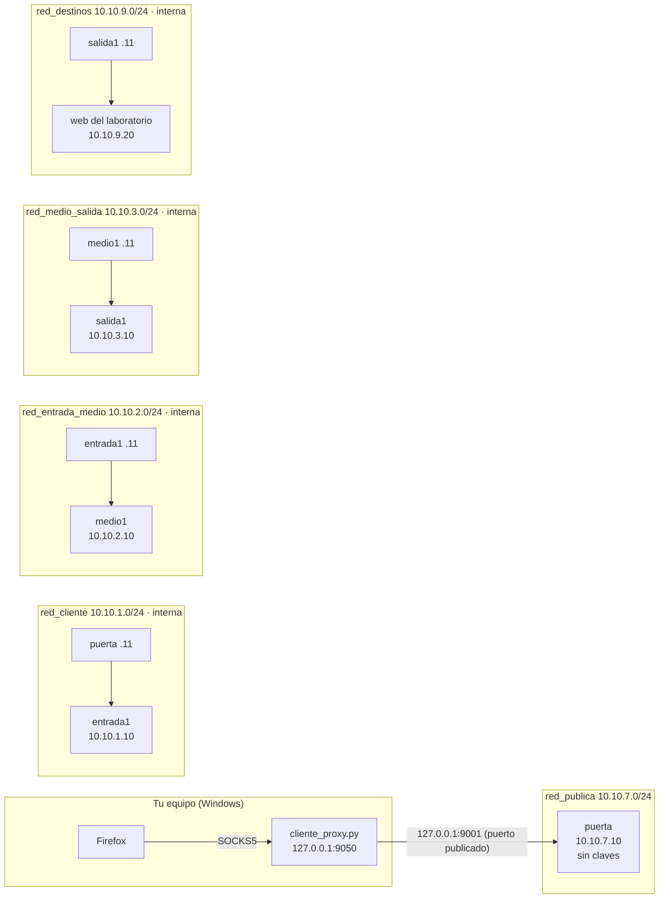

# Semana 4 · Laboratorio Docker con redes segmentadas

Hasta la semana 3 los tres relays corrían en el mismo computador, todos en
`127.0.0.1`: cualquiera podía hablar con cualquiera. En la semana 4 cada relay vive
en su propio contenedor y **cada salto del circuito tiene su propia red**. Así se
demuestra el principio de ISO/IEC 27033: separar en zonas y permitir solo los flujos
necesarios entre ellas.

Probado de punta a punta en Linux el 08-11-2026 (Docker 29.9, Compose 5.6):
`python laboratorio_docker.py probar` → **Todo correcto**. Verificado también en
Windows 11 con Docker Desktop el 09-11-2026 (sección 5).

## 1. Diseño de las redes (ISO/IEC 27033)



| Red | Subred | Quién está | Qué se permite | Salida a Internet |
|---|---|---|---|---|
| `red_publica` | 10.10.7.0/24 | puerta | Tu equipo → puerta, solo por `127.0.0.1:9001` | Sí en Docker Desktop, solo la puerta, que no tiene claves |
| `red_cliente` | 10.10.1.0/24 | puerta, entrada1 | puerta → entrada1 | No (`internal: true`) |
| `red_entrada_medio` | 10.10.2.0/24 | entrada1, medio1 | entrada1 → medio1 | No (`internal: true`) |
| `red_medio_salida` | 10.10.3.0/24 | medio1, salida1 | medio1 → salida1 | No (`internal: true`) |
| `red_destinos` | 10.10.9.0/24 | salida1, web | salida1 → web del laboratorio | No (`internal: true`) |
| `red_internet` (opcional) | 10.10.8.0/24 | salida1 | salida1 → Internet (solo con `--con-internet`) | Sí, solo el relay de salida |

Cada relay escucha **solo** en su dirección del directorio. Por eso, desde cada red
se alcanza un único servicio, aunque haya dos nodos conectados:

| Desde | entrada1 | medio1 | salida1 | web | Internet |
|---|---|---|---|---|---|
| red_cliente | **sí** | no | no | no | no |
| red_entrada_medio | no | **sí** | no | no | no |
| red_medio_salida | no | no | **sí** | no | no |
| red_destinos | no | no | no | **sí** | no |

Esta tabla la produce `python laboratorio_docker.py probar`, conectando un contenedor
de prueba a cada red. Consecuencias:

- **Nadie puede saltarse un nodo.** La entrada no tiene ruta hacia la salida: un
  circuito de 2 saltos o un atajo no es posible por diseño de la red, además de por
  el protocolo (defensa en profundidad).
- **El destino nunca ve al usuario.** La web del laboratorio muestra la IP desde la
  que le llega la conexión: siempre es `10.10.9.11`, el relay de salida.
- **Un nodo comprometido queda encerrado.** Un atacante dentro de medio1 solo llega a
  la entrada y a la salida; no llega a Internet, a la red local ni a tu equipo.

## 2. Endurecimiento de los contenedores

| Medida | Dónde | Por qué | Norma |
|---|---|---|---|
| Usuario sin privilegios (10001) | `Dockerfile` (`USER`), `docker-compose.yml` | Un fallo en el relay no da root dentro del contenedor | ISO/IEC 27033 · CIS Docker Benchmark |
| Sistema de archivos de solo lectura | `read_only: true` | El relay no puede escribir nada en disco: ni registros ni archivos | ASVS 5.0 V16.2.5 (sin registros) |
| `/tmp` solo en memoria, privado y sin ejecución | `tmpfs ... noexec,nosuid,nodev,uid=10001,mode=0700` | El módulo `ssl` solo carga la clave TLS desde un archivo; el instante que existe está cifrado con una contraseña aleatoria de un solo uso y en RAM | ASVS 5.0 V11.1.1 |
| Sin capacidades del kernel | `cap_drop: [ALL]`, `no-new-privileges` | Nada de abrir sockets crudos, cambiar la red ni escalar privilegios | ISO/IEC 27033 · CIS Docker Benchmark |
| Límites de recursos | `pids_limit: 64`, `mem_limit: 256m`, `cpus: 0.5` | Un ataque de denegación de servicio no tumba el equipo | ASVS 5.0 V2.4.1 |
| **Registros de Docker apagados** | `logging: driver: none` | Docker guarda por defecto en disco todo lo que el contenedor imprime. Con `none`, `docker logs` responde que no hay nada que leer | ASVS 5.0 V16.2.5 · requisito "no registrar nada" |
| Cada relay recibe solo SUS claves, en solo lectura | `volumes: .../entrada1:/app/claves/entrada1:ro` | Comprometer un relay no expone las claves de los otros ni la de la autoridad | ASVS 5.0 V13.3.1 · SSDF PS.1.1 |
| Ninguna clave en la imagen | `.dockerignore` (claves/, `**/*.key`, config/) + `COPY` con lista blanca | Una clave copiada a una imagen queda en sus capas para siempre | SSDF PS.1.1 (lo vigila `revisar_secretos.py`, paso 7) |
| Contraseña sin archivos ni variables | `laboratorio_docker.py` + `ejecutar_relay.py --contrasena-por-entrada` | Se pide una vez con `getpass`, se comprueba descifrando una clave y se escribe en la entrada estándar de cada relay con `docker attach` | SSDF PS.1.1 |
| Solo se publica la puerta de la entrada, y solo en `127.0.0.1` | `ports: "127.0.0.1:9001:9001"` en el servicio `puerta` | Nadie de tu red local puede usar tus relays. La puerta reenvía únicamente hacia entrada1 y no guarda claves ni registros | ISO/IEC 27033 |
| Versiones fijas | `requirements.txt`, imagen `python:3.14-slim@sha256:...` | Construcciones repetibles: si alguien cambia la etiqueta en el registro, la construcción falla en vez de usar otra imagen | SSDF PW.4.1 |

## 3. Cambios en el código

| Cambio | Archivo | Motivo |
|---|---|---|
| `--entrada-via 127.0.0.1:PUERTO` | `cliente_proxy.py`, `cliente_prueba.py`, `proxy.argumento_entrada_via`, `CircuitoCliente(entrada_via=)`, `transporte.conectar(direccion=)` | Tu equipo no ve las IP `10.10.x` de Docker; llega a la entrada por el puerto publicado. Solo cambia **adónde** se conecta el primer salto: la identidad la sigue garantizando la huella TLS del directorio, y solo se acepta una IP de loopback. |
| Marca `"entrada"` en el directorio | `directorio.py`, `circuito.elegir_ruta`, `config/relays.json` | Igual que la marca *Guard* de Tor. Con redes segmentadas, la ruta tiene que ser entrada → medio → salida. Un relay no puede ser entrada y salida a la vez (vería la IP del cliente y el destino). Los directorios sin el campo siguen siendo válidos. |
| `--contrasena-por-entrada` | `ejecutar_relay.py` | En un contenedor no hay teclado: lee una línea de la entrada estándar (máximo 1024 caracteres). |
| `publicar-directorio --salida directorio.docker.json` | `admin.py` | El directorio de Docker (IP `10.10.x`) convive con el local (`127.0.0.1`). Solo acepta un nombre `directorio.<algo>.json` dentro de `config/`. |
| Anti-rollback por directorio | `proxy.ruta_ultima_version` | `directorio.docker.json` usa `config/ultima_version.docker`; con un contador común, uno de los dos se rechazaría como si fuera un ataque. |
| Paso 7 de la revisión de secretos | `revisar_secretos.py` | Falla si `.dockerignore` no excluye `claves/`, `**/*.key` y `config/`. |
| Modo Docker en el panel | `panel.py`, `control_red.py` (`orquestador=`), `laboratorio_docker.py` (`iniciar_con_contrasena`, `matriz_segmentacion`, `pausar`, `reanudar`, `contenedores_sin_registros`) | La demostración se maneja desde una sola ventana, con las mismas funciones que la línea de comandos. El controlador recibe el orquestador como parámetro, y por eso las pruebas usan uno simulado. |
| Archivos nuevos | `Dockerfile`, `.dockerignore`, `docker-compose.yml`, `docker-compose.internet.yml`, `config/politica_salida.docker.json`, `docker/servidor_web.py`, `docker/sonda.py`, `docker/puerta.py`, `laboratorio_docker.py` | Laboratorio, web de destino, sonda de pruebas, puerta de la entrada y orquestador. |

**Problema encontrado al probar:** con `read_only: true` el relay no arrancaba
("no se pudo abrir la clave"). El módulo `ssl` de Python solo carga la clave TLS desde
un archivo, y sin `/tmp` escribible no había dónde ponerla. Se resolvió con un `/tmp`
en memoria (`tmpfs`), privado del usuario del relay y sin permiso de ejecución. Así,
además, ese archivo temporal nunca toca un disco.

**Segundo problema encontrado:** el cliente elegía los dos primeros relays en orden
al azar y a veces empezaba por medio1, al que no tiene ruta. Por eso se agregó la
marca `"entrada"`.

**Tercer problema encontrado (Windows, 09-11-2026):** la primera prueba con Docker
Desktop mostró que desde `red_cliente` se llegaba a Internet. Esa red no era interna
porque Docker no publica puertos de una red `internal: true`, y desactivar el NAT solo
la aislaba en Linux: Docker Desktop saca el tráfico igual. Se resolvió agregando
`docker/puerta.py`, un reenviador TCP sin claves y con destino fijo. `red_cliente` ahora es
interna, entrada1 vive solo en redes internas y la puerta es el único contenedor en una
red con salida. Si alguien comprometiera la puerta, solo vería tráfico TLS cifrado.

## 4. Cómo usarlo (Windows)

### 4.1 Una sola vez: instalar Docker Desktop

1. Descargar Docker Desktop para Windows desde `https://docs.docker.com/desktop/` e
   instalarlo con la opción **WSL 2**, que es la predeterminada.
2. Reiniciar si lo pide, abrir Docker Desktop y esperar a que diga **Engine running**.
3. Comprobar en PowerShell: `docker version` y `docker compose version`.

### 4.2 Cada vez

```powershell
cd C:\Users\Harpe\OneDrive\Desktop\MiniOni
.\.venv\Scripts\Activate.ps1

python laboratorio_docker.py preparar      # firma config/directorio.docker.json (cada 7 días)
python laboratorio_docker.py iniciar       # la primera vez descarga python:3.14-slim
python laboratorio_docker.py probar        # segmentación, punta a punta y fallo cerrado
python laboratorio_docker.py estado        # endurecimiento de cada contenedor

# Navegar (otra ventana de PowerShell, con el entorno activo):
python cliente_proxy.py --directorio config/directorio.docker.json --entrada-via 127.0.0.1:9001
# Firefox con el proxy 127.0.0.1:9050 (docs/NAVEGADOR.md) -> http://web/
curl.exe --socks5-hostname 127.0.0.1:9050 http://web/

python laboratorio_docker.py eventos salida1    # consola en vivo de un relay (no se guarda)
python laboratorio_docker.py detener            # borra contenedores y redes
```

Para navegar también por Internet, usa `python laboratorio_docker.py iniciar --con-internet`.
Solo el relay de salida se conecta a una red con Internet; los demás siguen aislados.

### 4.3 Actualizar la imagen base (SSDF PW.4.1)

La imagen está fijada por su *digest* en `Dockerfile` (`ARG BASE`), en `docker/Dockerfile.captura` (semana 5) y en
`docker-compose.yml` (valor por defecto de `MINIONI_IMAGEN_BASE`). El digest vigente
se obtuvo del registro de Docker Hub el 08-11-2026 y corresponde a la lista multiarquitectura.
Para pasar a una versión nueva, por ejemplo cuando salga un parche de seguridad:

```powershell
docker pull python:3.14-slim
docker inspect --format "{{index .RepoDigests 0}}" python:3.14-slim
# Copiar el resultado (python@sha256:...) con la forma python:3.14-slim@sha256:... en los DOS archivos
python -m pytest -q tests/test_semana4_docker.py    # exige el digest y que coincida en ambos
python laboratorio_docker.py iniciar
python laboratorio_docker.py probar                 # debe terminar en «Todo correcto»
```

### 4.4 Desde el panel gráfico

`python panel.py` y, en la cabecera, elegir **Docker**. Se puede cambiar de modo solo
con la red detenida.

- **Firmar directorio Docker** equivale a `preparar`.
- **Iniciar red** usa la contraseña escrita en el panel, la comprueba, levanta el
  laboratorio y arranca el proxy con la entrada `127.0.0.1:9001`. La casilla *Internet
  solo para el relay de salida* equivale a `--con-internet`.
- **Apagar / Encender** en cada relay usa `docker pause` y `docker unpause`.
- Mientras arranca, solo se muestra «Fase N de 4 en proceso»: comprobar la configuración,
  preparar el entorno, conectar los nodos y abrir el acceso. Ni la terminal ni el panel
  muestran comandos o salida de Docker (ASVS 5.0 V16.5.1).
- **Probar segmentación** muestra la matriz en el cuadro de eventos.
- **Verificar sin registros** busca el testigo en `http://web/` (o en el buscador real
  si el laboratorio tiene Internet) y además comprueba que Docker reporte registros
  apagados y disco de solo lectura en todos los contenedores.
- Mientras Docker está trabajando la ventana no se puede cerrar, para no dejar
  contenedores a medio crear. Al cerrarla con la red en marcha se apaga el laboratorio.
- Con `--carpeta RUTA` el modo Docker queda desactivado, porque esas claves no son las
  que monta Docker.

## 5. Resultado de la prueba (Linux, 08-11-2026)

```
Segmentación (ISO/IEC 27033): a qué llega un equipo conectado a cada red
  red                entrada1  medio1    salida1   web       internet  resultado
  red_cliente        sí        no        no        no        no        OK
  red_entrada_medio  no        sí        no        no        no        OK
  red_medio_salida   no        no        sí        no        no        OK
  red_destinos       no        no        no        sí        no        OK

De punta a punta, desde la red del cliente (sonda con el proxy de MiniOni):
  [OK   ] Eco por 3 saltos
  [OK   ] Página de http://web/ por el proxy SOCKS5
  [OK   ] El destino ve al relay de salida (10.10.9.11), no al cliente
  [OK   ] Puerto 22 bloqueado por la política de salida
  [OK   ] Relay interno 10.10.2.10 bloqueado como destino

Desde este equipo (entrada publicada en 127.0.0.1:9001):
  [OK   ] Eco por 3 saltos usando la entrada publicada

Fallo cerrado (se pausa medio1 unos segundos):
  [OK   ] Con medio1 en pausa la conexión falla (no hay ruta alternativa)
  [OK   ] Al reanudar medio1 los circuitos vuelven a funcionar

Todo correcto.

  contenedor        estado     usuario      solo lect.  capacidades  registros
  minioni-entrada1  running    10001:10001  sí          ninguna      none
  minioni-medio1    running    10001:10001  sí          ninguna      none
  minioni-salida1   running    10001:10001  sí          ninguna      none
  minioni-web       running    10001:10001  sí          ninguna      none
```

Además: `curl --socks5-hostname 127.0.0.1:9050 http://web/` desde el equipo mostró
`10.10.9.11`; `docker logs minioni-entrada1` respondió *"configured logging driver
does not support reading"*; y una contraseña incorrecta se rechaza 3 veces sin
arrancar ningún contenedor.

### Verificación en Windows (09-11-2026)

Windows 11 Pro, Docker Desktop con WSL 2, Docker 29.9.2 y Compose 5.6.1. La imagen se
construyó con el digest fijado y no contiene claves ni `config/`.

| Comprobación | Resultado |
|---|---|
| Primera ejecución de `probar` | **FALLO**: `red_cliente` llegaba a Internet (tercer problema de la sección 3) |
| `probar` con la puerta, modo cerrado | **Todo correcto**: la misma matriz de la tabla de arriba, punta a punta y fallo cerrado |
| Desde dentro de `entrada1` y `medio1` | Sin Internet; cada uno alcanza solo sus dos redes |
| `estado` | Los 5 contenedores con usuario 10001, solo lectura, sin capacidades y registros `none` |
| `docker logs` en los 5 contenedores | *"configured logging driver does not support reading"* |
| Puertos publicados | Solo `minioni-puerta`, en `127.0.0.1:9001` |
| `curl.exe --socks5-hostname` a `http://web/` | Muestra `10.10.9.11` |
| `curl.exe` a `https://example.com`, modo cerrado | Bloqueado |
| Panel en modo Docker, con Internet solo para la salida | *Red en marcha*; `http://web/` responde HTTP 200 por 3 saltos |
| `https://example.com` con Internet | HTTP 200; `probar` sigue en **Todo correcto** y solo `salida1` está en `red_internet` |
| Firefox por el proxy a `http://web/` | Muestra `10.10.9.11` |

Firefox necesita la casilla **Usar proxy DNS cuando se use SOCKS v5**. Sin el proxy
configurado, muestra *"Servidor no encontrado"* porque busca `web` en el equipo.

## 6. Evidencia sugerida para el informe

| # | Qué capturar | Cómo |
|---|---|---|
| 1 | Las 4 redes internas y `red_publica`, con sus subredes | `docker network ls` y `docker network inspect minioni_red_entrada_medio` (`"Internal": true`) |
| 2 | Matriz de segmentación y pruebas de punta a punta | `python laboratorio_docker.py probar` |
| 3 | Endurecimiento de los contenedores | `python laboratorio_docker.py estado` |
| 4 | Docker no guarda registros | `docker logs minioni-salida1` → *"does not support reading"* |
| 5 | El destino ve al relay de salida, no a tu equipo | Firefox por el proxy → `http://web/` (muestra 10.10.9.11) |
| 6 | Ninguna clave en la imagen | `.dockerignore` y `python revisar_secretos.py` (paso 7) |
| 7 | Fallo cerrado | Parte final de `probar`, o `docker pause minioni-medio1` y recargar Firefox |

## 7. Qué queda para la semana 5

- Captura con Wireshark del tramo entrada → medio (`red_entrada_medio`): solo debe
  verse TLS 1.3 con registros de tamaño fijo, nunca el destino ni el contenido.
- Informe final y guion de la demostración (`docs/PLAN_ENTREGA_SEMANA5.md`).
