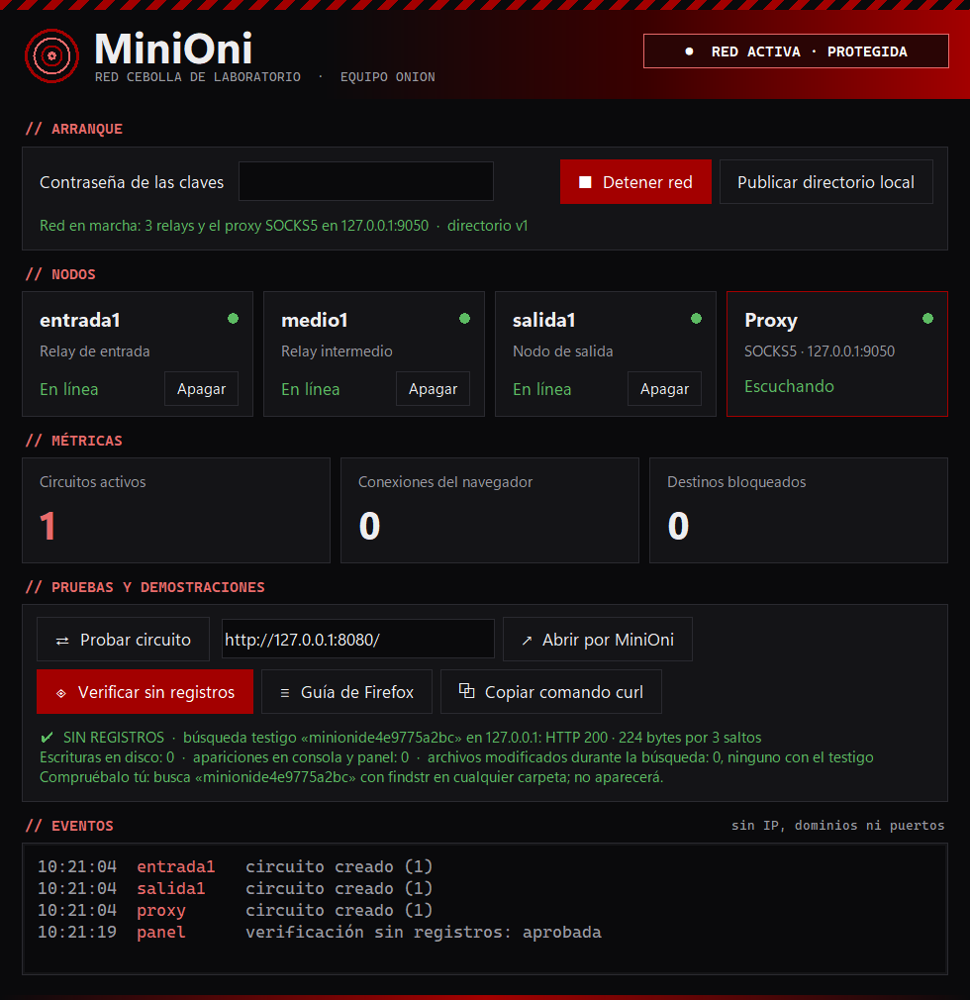

# Cómo demostrar que MiniOni no registra las búsquedas

La afirmación «MiniOni no registra las búsquedas» se divide en dos partes, y
cada una se demuestra de forma distinta:

1. **MiniOni no guarda nada**: ni en disco, ni en la consola, ni en el panel.
2. **Ningún punto intermedio ve la búsqueda completa**: el tráfico va cifrado
   en 3 capas y el nombre del sitio se resuelve en el nodo de salida.

## 1. Verificación automática (botón del panel)

`python panel.py` → escribe la contraseña → **▶ Iniciar red** → **◈ Verificar sin registros**.

Qué hace (`minioni/sin_registros.py`, `ControladorRed.verificar_sin_registros`):

1. Inventa un **testigo**, una palabra al azar como `minioni3a7f0c91e2d4` que
   no existe en ningún otro sitio, y la busca en DuckDuckGo a través del
   proxy y del circuito de 3 saltos.
2. Mientras dura la búsqueda:
   - **Vigía de escrituras**: los *audit hooks* de Python (PEP 578) anotan
     cada intento del proceso de abrir un archivo para escribir, crear,
     renombrar o borrar. Los relays, el proxy y el panel corren en ese
     mismo proceso, así que nada de MiniOni puede escribir sin que se vea.
   - **Espejo de consola**: copia todo lo que se imprime.
3. Al terminar, busca el testigo y el dominio en todos los archivos
   modificados durante la búsqueda: proyecto, `config`, `claves` y carpeta
   temporal. También los busca en el registro de eventos del panel.

El resultado se ve en el panel:



**Aprobado** = 0 escrituras en disco, 0 apariciones en consola y en el panel, y
0 archivos con el testigo.

### ¿Cómo sé que el detector no está «ciego»?

`tests/test_sin_registros.py` incluye pruebas negativas. La más importante,
`test_un_minioni_con_fugas_es_detectado`, simula una versión de MiniOni que
**sí** guarda la búsqueda en `historial.log` y la imprime. La verificación
debe reprobar y señalar ese archivo, y lo hace. Otras pruebas comprueban que
el vigía ve `open` en modo escritura, `os.open` con `O_CREAT`, renombrados y
borrados, y que el buscador de archivos encuentra el testigo también en
UTF-16.

## 2. Compruébalo tú, fuera de Python

El panel muestra el testigo. Con el panel ya cerrado, búscalo en PowerShell:

```powershell
findstr /s /i /m "minioni3a7f0c91e2d4" C:\Users\TU_USUARIO\OneDrive\Desktop\MiniOni\*
findstr /s /i /m "minioni3a7f0c91e2d4" %TEMP%\*
```

Si no aparece ningún archivo, no queda registro.

**Con Process Monitor** (Microsoft Sysinternals): filtro `Process Name is
python.exe` y `Operation is WriteFile`. Navega por MiniOni: no aparece
ninguna escritura. Esto lo ve el sistema operativo, no Python.

**Con Wireshark** (interfaz *Adapter for loopback traffic capture*):

- Entre los relays (puertos 9001-9003) solo hay TLS 1.3: no se lee ni la
  búsqueda ni el dominio.
- Del navegador al proxy (9050) va el pedido SOCKS5 con el nombre del sitio,
  pero sin salir del equipo; el navegador no hace consultas DNS propias
  (`network.proxy.socks_remote_dns = true`).

## 3. Lo que NO demuestra (para el informe)

- **El buscador sí ve la búsqueda.** DuckDuckGo o Google la reciben; lo que
  no saben es *quién* la hizo, porque ven la IP del nodo de salida. En un
  solo computador esa IP es la tuya: el anonimato frente al buscador se
  demuestra en la semana 4, con Docker.
- **Con HTTPS, el nodo de salida ve el dominio pero no la búsqueda.** Con
  `http://` podría ver el contenido; no lo guarda (sección 1).
- **Windows actúa por su cuenta.** La resolución DNS del nodo de salida pasa
  por la caché DNS de Windows (`ipconfig /displaydns` mostrará el dominio,
  pero no la búsqueda). En una red real, esa caché está en el equipo del
  nodo de salida, no en el tuyo. El archivo de paginación tampoco lo
  controla Python.
- **El navegador guarda historial.** Usa una ventana privada.
- La verificación solo cubre la búsqueda que hace ella misma; para tus
  propias búsquedas, usa el método `findstr` de la sección 2.
